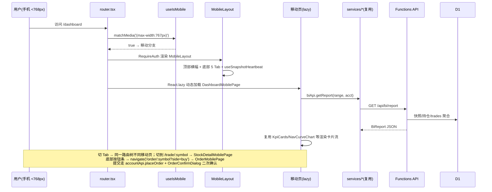

# 炒炒乐移动端支持 — 增量架构设计与任务分解

> 架构师：高见远（Bob） ｜ 基于 docs/prd-mobile.md（许清楚，v1.0）+ 现有代码实况核实
> 硬约束：**PC 端零回归**——受影响既有文件仅 `src/router.tsx` 与 `index.html` 两处；全部移动代码隔离在 `src/mobile/`。零成本红线不变。

---

## 1. 实现方案与关键决策

### 1.1 现状核实（与 PRD 假设的出入）

| PRD 假设 | 实际代码 | 影响 |
|---|---|---|
| 布局在 `src/components/AppLayout.tsx` | 实际在 `src/layouts/AppLayout.tsx` | 无影响，本设计不动它 |
| 主题在 `src/themes/muji-theme` | 实际在 `src/theme/muji-theme.ts`，且 `ThemeProvider` 挂在 `src/App.tsx` 根层 | **移动端主题零改动**：直接吃同一份 mujiTheme |
| BI/大比拼/消息已存在 | DashboardPage + dashboard/*、ContestsPage + contest/*、MessageBell、AccountSettingsDialog、use-snapshot-heartbeat 均已实现 | 移动版直接复用其数据层与部分组件 |
| `shared/money.ts` | 已存在：`toCents/toYuan/formatYuan/formatSignedYuan/formatPct/formatAmountShort` | 移动端直接复用，不新建换算工具 |

### 1.2 关键决策

1. **`useIsMobile` 放 `src/hooks/use-is-mobile.ts`**（公共 hooks 目录，不放 src/mobile/——router.tsx 需要引用它，router 属共享层）。实现：`matchMedia('(max-width: 767px)')` + `change` 监听，SSR 安全（无 window 时返回 false），返回布尔值。
2. **路由分支：`<ResponsiveRoute pc mobile>` 包装组件**，写在 `src/router.tsx` 内部（不新建文件，改动集中一处）。单一 `<Routes>` 树、路径完全不变，仅渲染时按宽度二选一。窄屏拉宽窗口即时切回 PC 版（matchMedia 响应式），无双地址、无维护成本。
3. **懒加载策略**：PC 页面保持现状静态 import（**零行为变更**）；全部移动页面 `React.lazy` + `<Suspense>`，Vite 自动按移动页分包，PC 首屏体积零增加。`MobileLayout` 静态 import（轻量框架组件，且 RequireAuth 需要它做即时布局分发）。
4. **M4 下单页独立路由 `/order/:symbol`**：移动端个股详情底部按钮条与持仓卡片「快捷交易」跳 `navigate('/order/sh600519?side=buy')`；该路由 PC 侧渲染 `<Navigate to="/trade/:symbol">` 兜底（用户在窄屏下单时拉宽窗口也不 404）。
5. **MobileLayout 结构**：`height: 100dvh`（替代 100vh，规避移动浏览器地址栏抖动）；顶部模拟盘横幅压缩至 24px；内容区 `flex:1 + overflow:auto` 独立滚动；底部 5 Tab（MUI BottomNavigation，高 52px + `env(safe-area-inset-bottom)` 适配 iPhone 底部安全区）。`/order` 路由隐藏 Tab 条（全屏表单沉浸）。**MobileLayout 内挂载 `use-snapshot-heartbeat()`**——与 PC AppLayout 互斥渲染，同一时刻只有一份心跳，无需改动。
6. **主题复用方式**：不 fork 移动主题。新建 `src/mobile/theme.ts` 仅导出**触控规范常量与公共 sx 工厂**（`TOUCH_MIN=44`、`BTN_H=48`、`TAB_H=52`、`touchBtnSx()`、`cardSx()`），视觉变量全部读 `MUJI`。
7. **图表复用**：KpiCards/NavCurveChart/DailyPnlChart/AllocationDonut/TopContributionChart/PnlRatioDonut/ConcentrationCard、QuoteHeader、KLineChart、MinuteChart、NewsList、StockSearch、OrderConfirmDialog、OpenAccountDialog（全屏化：`fullScreen` prop 传入即可，MUI Dialog 原生支持）**直接 import 复用**，移动页只做容器与布局适配，不复制逻辑。

### 1.3 新增/受影响文件总览

**新增（src/hooks + src/mobile/，共 24 个）**

| 文件 | 职责 |
|---|---|
| `src/hooks/use-is-mobile.ts` | 设备判定 hook（<768px，matchMedia + change 监听） |
| `src/mobile/index.ts` | 桶文件：集中导出全部 lazy 页面，router 只 import 这一处 |
| `src/mobile/theme.ts` | 触控常量（44/48/52）+ 公共 sx 工厂 + 安全区变量 |
| `src/mobile/layouts/MobileLayout.tsx` | 顶部 24px 横幅 + 内容滚动区 + 底部 5 Tab + 心跳挂载 |
| `src/mobile/pages/LoginMobilePage.tsx` | M1 登录（单列竖排、≥48px 输入与按钮、密码显隐、Snackbar） |
| `src/mobile/pages/RegisterMobilePage.tsx` | M1 注册 |
| `src/mobile/pages/ForgotPasswordMobilePage.tsx` | M1 忘记密码 |
| `src/mobile/pages/DashboardMobilePage.tsx` | M2 BI 卡片流（复用全部 dashboard 图表，KPI 2 列网格） |
| `src/mobile/pages/MarketListMobilePage.tsx` | M3 行情列表（搜索置顶 + 大盘推荐/我的自选 Tab + 股票卡片） |
| `src/mobile/pages/StockDetailMobilePage.tsx` | M3 个股详情（QuoteHeader + 周期 Tab + 图表 + 新闻 + 底部买卖条） |
| `src/mobile/pages/OrderMobilePage.tsx` | M4 全屏下单（账户选择 + 买/卖 Segmented + 数字键盘 + 二次确认复用） |
| `src/mobile/pages/AccountListMobilePage.tsx` | M5 账户卡片列表 + 全屏开户 |
| `src/mobile/pages/AccountDetailMobilePage.tsx` | M6 资产总览 2×2 + 四 Tab 卡片流 + 撤单 + 快捷交易 |
| `src/mobile/pages/ContestsMobilePage.tsx` | M7 大比拼（P1） |
| `src/mobile/pages/MessagesMobilePage.tsx` | M8 消息列表（P1） |
| `src/mobile/pages/MeMobilePage.tsx` | M9 个人中心（P1，改密/资料/退出/免责声明/消息入口） |
| `src/mobile/components/StockQuoteCard.tsx` | 行情卡片（名称/现价/涨跌%/涨跌额，整卡 ≥48px 可点，删除按钮常显） |
| `src/mobile/components/PositionCard.tsx` | 持仓卡片（成本 vs 现价/盈亏/「交易」「一键清仓」常显按钮） |
| `src/mobile/components/OrderCard.tsx` | 委托卡片（含 ≥44px 撤单按钮 + 二次确认） |
| `src/mobile/components/RecordCardList.tsx` | 成交/流水时间线卡片（按日期分组头） |
| `src/mobile/components/AssetSummaryGrid.tsx` | 2×2 资产总览网格（总资产/现金/市值/今日盈亏） |
| `src/mobile/components/TradeButtonBar.tsx` | 个股详情底部固定「买入/卖出」双按钮条 |
| `src/mobile/components/SegmentedControl.tsx` | 横向滚动 Segmented（买/卖、时间范围、周期切换通用） |
| `src/mobile/components/PriceField.tsx` | 价格/数量输入（`inputMode="decimal"`、步进按钮、费用预估） |

**受影响既有文件（仅 2 个）**

| 文件 | 改动 |
|---|---|
| `src/router.tsx` | ① 内部新增 `ResponsiveRoute` 组件与 `RequireAuth` 按宽度选布局；② 移动页 lazy import；③ 新增 `/order/:symbol`、`/me`、`/messages` 三条路由（PC 侧兜底重定向）。PC 页面 import 与路径零变更 |
| `index.html` | viewport 改为 `width=device-width, initial-scale=1, maximum-scale=1, user-scalable=no, viewport-fit=cover` |

---

## 2. 数据结构与接口约定

### 2.1 `ResponsiveRoute`（router.tsx 内部）

```tsx
function ResponsiveRoute({ pc, mobile }: { pc: React.ReactNode; mobile: React.ReactNode }): JSX.Element
// useIsMobile() 为 true 渲染 mobile，否则 pc
```

`RequireAuth` 改为按宽度渲染 `<AppLayout><Outlet/></AppLayout>` 或 `<MobileLayout><Outlet/></MobileLayout>`；未登录/加载中分支不变。

### 2.2 移动组件 Props 约定（与 PC 组件对齐，直接消费 services/store 类型）

```ts
// StockQuoteCard
interface StockQuoteCardProps {
  symbol: StockSymbol; name: string; quote: Quote | undefined;
  onDelete?: () => void;        // 自选删除，常显不依赖 hover
  onClick?: () => void;
}
// PositionCard
interface PositionCardProps {
  position: Position; quote: Quote | undefined;
  onTrade: () => void; onLiquidate: () => void;   // 常显按钮
}
// SegmentedControl<T extends string>
interface SegmentedControlProps<T extends string> {
  value: T; options: { value: T; label: string }[];
  onChange: (v: T) => void; scrollable?: boolean;   // 超宽时横向滚动
}
// PriceField
interface PriceFieldProps {
  label: string; value: string; onChange: (v: string) => void;
  step?: number; max?: number; hint?: string;       // hint：可用资金/可卖股数
}
// MobileLayout
function MobileLayout({ children }: PropsWithChildren): JSX.Element
// 内部按 useLocation() 判断 pathname.startsWith('/order') 时隐藏底部 Tab
```

不新增任何全局 store、不新增 API service——移动页数据全部走既有 `authApi/accountApi/marketApi/watchlistApi/contestApi/biApi/messageApi` 与 `useQuotePolling`、`useAuthStore/useQuoteStore`。

---

## 3. 程序调用流程（时序图）



---

## 4. 任务列表（有序，P0 先行）

| # | 任务 | 预估文件 | 依赖 | 验收标准 | 优先级 |
|---|---|---|---|---|---|
| **T1** | 设备分发框架：useIsMobile + ResponsiveRoute 路由分支 + MobileLayout + 触控主题 | `src/hooks/use-is-mobile.ts`、`src/router.tsx`(改)、`index.html`(改)、`src/mobile/index.ts`、`src/mobile/theme.ts`、`src/mobile/layouts/MobileLayout.tsx` | 无 | 窄屏所有路径渲染 MobileLayout（横幅+5Tab+安全区），宽屏与改造前完全一致；移动页暂以空占位；窄/宽窗口拖拽即时切换；vite build 分包含 mobile chunk | **P0** |
| **T2** | 认证 + 账户列表移动版（M1+M5） | `LoginMobilePage`、`RegisterMobilePage`、`ForgotPasswordMobilePage`、`AccountListMobilePage`、`AssetSummaryGrid`(首次落地) | T1 | 手机宽度完成登录/注册/忘记密码全流程（email/数字 inputMode、密码显隐、Snackbar 反馈）；账户卡片列表 + 全屏开户 Dialog 可用；输入与按钮 ≥48px；PC 端 LoginPage 冒烟无变化 | **P0** |
| **T3** | 行情两级页 + 下单页（M3+M4） | `MarketListMobilePage`、`StockDetailMobilePage`、`OrderMobilePage`、`StockQuoteCard`、`TradeButtonBar`、`SegmentedControl`、`PriceField` | T1 | 搜索/大盘推荐/自选 Tab、股票卡片点入详情；QuoteHeader+分时/K线周期 Tab+加自选+新闻流正常；底部买卖条→全屏下单表单（数字键盘、费用预估、二次确认复用 OrderConfirmDialog、废单 Snackbar）；轮询复用 useQuotePolling；PC 端 /trade/:symbol 冒烟无变化 | **P0** |
| **T4** | 账户详情 + BI 移动版（M6+M2） | `AccountDetailMobilePage`、`DashboardMobilePage`、`PositionCard`、`OrderCard`、`RecordCardList` | T1（数据依赖 T3 的卡片组件可并行，无硬依赖） | 资产总览 2×2 + 四 Tab（持仓/委托/成交/流水）卡片流；撤单（≥44px+二次确认）与「交易」「一键清仓」可用，轮询含 tick 撮合；BI 卡片流：账户/时间 Segmented→KPI 2 列→净值曲线(220px)→每日盈亏→持仓卡片→TOP 条形，全图表渲染；URL query 联动保持 | **P0** |
| **T5** | P1 页面 + 全量集成回归（M7/M8/M9） | `ContestsMobilePage`、`MessagesMobilePage`、`MeMobilePage`（含免责声明全文、消息入口与 badge、退出） | T1~T4 | 大比拼（挑战/邀请/排行 30s 刷新/取消）、消息列表（点击已读）、个人中心可用；Tab「我的」badge 未读数；**回归验收：vite build + tsc --noEmit + vitest 全绿；PC 端全路径冒烟（登录→报表→行情→下单→账户详情）零差异** | **P1** |

---

## 5. 依赖包列表

**零新增**。React.lazy/Suspense、MUI BottomNavigation/Dialog(fullScreen)、matchMedia 均为现有依赖能力（react@18.3 / @mui/material@5.16 / react-router-dom@6.26）。

---

## 6. 共享知识（跨文件约定）

1. **金额**：API/状态层一律整数「分」；分↔元与格式化**只用 `shared/money.ts`**（`toYuan/formatYuan/formatSignedYuan/formatPct/formatAmountShort`），移动组件禁止自行 `toFixed`。
2. **API 错误处理**：`http.ts` 抛错含业务码；移动页统一 catch 后用 MUI `Snackbar`（顶部）展示 `message`，禁止 alert/tooltip；静默类错误（轮询降级、心跳）沿用 PC 约定不弹窗。
3. **触控规范常量**（`src/mobile/theme.ts` 唯一定义处）：`TOUCH_MIN=44`（最小触控目标）、`BTN_H=48`（全宽主按钮/输入框）、`TAB_H=52`（底部 Tab）；禁止组件内散落硬编码尺寸。
4. **零 hover 依赖**：一切操作按钮（自选删除、撤单、交易、清仓）常显；反馈一律 Snackbar/状态变化。
5. **布局**：移动页外层统一 `height:'100dvh'` 滚动区由 MobileLayout 提供，页面自身不设 100vh；底部安全区 `paddingBottom: env(safe-area-inset-bottom)` 只在 MobileLayout 处理。
6. **路由**：路径 PC/移动完全一致，仅 `/order/:symbol`、`/me`、`/messages` 为移动主导航达路径（PC 有重定向兜底）；移动页间跳转一律 `useNavigate`，禁止 `window.location`。
7. **隔离红线**：`src/mobile/**` 不得 import `src/pages/**`（页面级），可 import `src/components/**` 复用件、`src/services|store|hooks|theme`、`shared/*`；反向（PC import mobile）禁止。
8. **日期/颜色**：沿用 `dayjs` 与 `MUJI` 红涨绿跌（up #d93025 / down #00a854），移动端不引入新色值。

---

## 7. 待明确事项

1. **断点**：默认 <768px 走移动版（iPad 竖屏 768px 走 PC 版），与 PRD 假设一致，如需 iPad 专属优化另立 P2。
2. **`/me`、`/messages`、`/contests` 的 PC 兜底**：P1 期间 PC 侧 `/me`、`/messages` 重定向 `/dashboard`（PC 无此独立页）；工程师实现时如发现 PC 已有对应能力（AccountSettingsDialog/MessageBell）保持不动即可。
3. **M2 图表性能**：每日盈亏柱状图与归因图默认全保留（PRD 默认值），低端机若卡顿降级表格属 P1 优化，不在本期任务验收内。
4. **下拉刷新手势**：P0 为轮询+手动刷新按钮，P1 再评估（原生 touch 事件实现，无新依赖）。
5. **viewport 禁缩放**：`user-scalable=no` 对无障碍（Accessibility）有折扣，PRD 已明确防输入聚焦缩放优先——按 PRD 执行，如法务/无障碍提出异议再回退为 `maximum-scale=1`。
6. **Tab badge**：「我的」Tab 未读数依赖 `messageApi` 轮询频率，P0 暂不轮询 badge（仅进入「我的」时刷新），P1 优化为 60s 一次。
