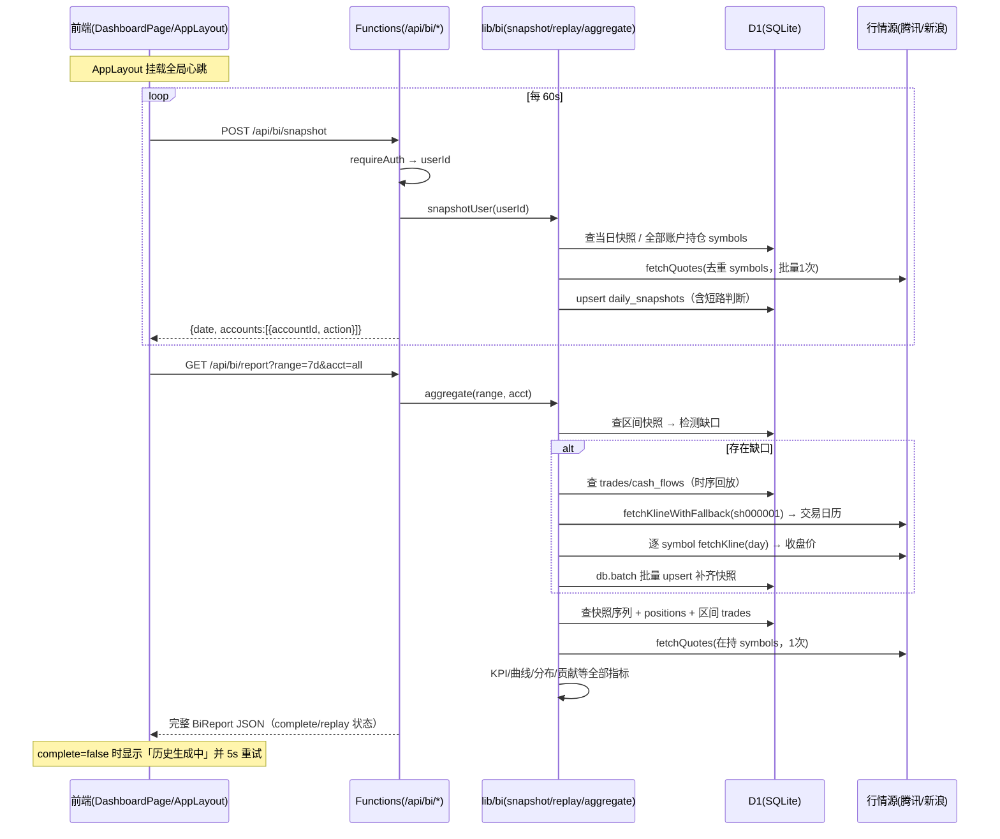

# 炒炒乐 BI 报表首页 — 增量架构设计与任务分解

> 架构师：高见远（Bob） ｜ 基于 PRD（已确认）与 stock-sim-cn 现有代码实况
> 红线：Cloudflare Pages + Functions + D1，零成本；金额全链路整数「分」；日期为东八区交易日 `YYYY-MM-DD`。

---

## 1. 增量架构总览

### 1.1 设计思路

- **零成本快照**：不引入任何付费服务。快照复用登录态全局心跳（AppLayout 每 60s 一次 `POST /api/bi/snapshot`），服务端短路控制上游行情调用量（每账户每天最多 2 次：盘中首次 + 收盘后覆盖一次）。
- **交易日历白嫖**：A 股交易日序列直接取自 `sh000001`（上证指数）日 K 的 date 列——一次腾讯日 K 请求同时解决「是否交易日」与「区间交易日序列」，模块级缓存 10 分钟，失败回退「工作日即交易日」。
- **单聚合端点**：BI 报表一次请求返回 range+acct 维度的全部 P0 指标与序列（理由见 §3）。
- **历史回放懒触发**：并入聚合端点——进入 BI 时检测快照缺口，缺口存在则同步回放（每次请求封顶 120 个交易日，未补完返回 `complete:false`，前端提示「历史数据生成中」并定时重试），避免超时。
- **P1 预留**：回放时序推进函数同时产出逐笔已实现盈亏，P1 的胜率/盈亏比/交易频次可直接复用；report 响应结构预留可扩展字段，本次不实现。

### 1.2 新增 / 修改文件清单

**后端（functions/）**

| 文件 | 类型 | 说明 |
|---|---|---|
| `migrations/0003_daily_snapshots.sql` | 新增 | daily_snapshots 建表 + 索引 |
| `functions/lib/trading-day.ts` | 新增 | 东八区交易日工具：交易日判断、交易日序列（基于 sh000001 日 K + 模块缓存）、日期加减 |
| `functions/lib/bi/snapshot.ts` | 新增 | 当日快照幂等 upsert + 短路逻辑 |
| `functions/lib/bi/replay.ts` | 新增 | 历史快照回放补齐（收盘价批量获取、D1 批量写入、限流） |
| `functions/lib/bi/aggregate.ts` | 新增 | BI 聚合指标计算（KPI/序列/持仓维度） |
| `functions/api/bi/snapshot.ts` | 新增 | POST 快照采集端点 |
| `functions/api/bi/report.ts` | 新增 | GET BI 聚合端点（含懒触发回放） |
| `shared/types.ts` | 修改 | 增补 BI 相关类型（BiReport、SnapshotResult、Range 等，前后端共用） |

**前端（src/）**

| 文件 | 类型 | 说明 |
|---|---|---|
| `src/services/bi-api.ts` | 新增 | getReport / postSnapshot 封装（复用 http.ts） |
| `src/hooks/use-snapshot-heartbeat.ts` | 新增 | 登录后全局 60s 心跳，fire-and-forget |
| `src/pages/DashboardPage.tsx` | 新增 | BI 首页：URL 状态驱动 + 数据获取 + 布局 |
| `src/components/dashboard/chart-theme.ts` | 新增 | Recharts 主题封装（红涨绿跌/轴/tooltip） |
| `src/components/dashboard/RangeSelector.tsx` | 新增 | 时间范围选择（写 URL query） |
| `src/components/dashboard/AccountSelector.tsx` | 新增 | 账户切换（全部/单账户，写 URL query） |
| `src/components/dashboard/KpiCards.tsx` | 新增 | 7 张 KPI 卡片 |
| `src/components/dashboard/NavCurveChart.tsx` | 新增 | 资产净值曲线（面积图，金额/净值双视图） |
| `src/components/dashboard/DailyPnlChart.tsx` | 新增 | 每日盈亏柱状图（正红负绿） |
| `src/components/dashboard/PositionsCompareTable.tsx` | 新增 | 持仓成本 vs 现价对比表 |
| `src/components/dashboard/AllocationDonut.tsx` | 新增 | 持仓市值分布环形（含现金扇区） |
| `src/components/dashboard/ConcentrationCard.tsx` | 新增 | 持仓集中度（top1/top5 占比） |
| `src/components/dashboard/TopContributionChart.tsx` | 新增 | 单股盈亏贡献 TOP10 正负双向条形 |
| `src/components/dashboard/PnlRatioDonut.tsx` | 新增 | 个股盈亏占比环形 |
| `src/router.tsx` | 修改 | 新增 /dashboard；`/`、登录后跳转改为 /dashboard |
| `src/layouts/AppLayout.tsx` | 修改 | 导航改「分析报告（默认）/我的账户/行情」；挂载快照心跳 |
| `package.json` | 修改 | 新增 `recharts` 依赖 |

### 1.3 数据流时序图



---

## 2. 数据模型

### 2.1 `migrations/0003_daily_snapshots.sql`（完整 DDL）

```sql
-- 0003_daily_snapshots.sql — BI 每日快照
-- 约定沿用 0001：金额整数「分」；date 为东八区交易日 YYYY-MM-DD；时间为 ISO 8601 UTC。

CREATE TABLE daily_snapshots (
  user_id        INTEGER NOT NULL,
  account_id     INTEGER NOT NULL REFERENCES trade_accounts(id),
  date           TEXT    NOT NULL,              -- 交易日 'YYYY-MM-DD'（东八区）
  total_assets   INTEGER NOT NULL,              -- 总资产（分）= cash + market_value
  cash           INTEGER NOT NULL,              -- 现金（分）= cash_available + frozen_cash
  market_value   INTEGER NOT NULL,              -- 持仓市值（分）= Σ(qty × 现价/收盘价)
  day_pnl        INTEGER NOT NULL DEFAULT 0,    -- 当日盈亏（分）= 当日资产 − 上一交易日快照资产
  snapshotted_at TEXT    NOT NULL,              -- 采集时间 ISO 8601 UTC（收盘覆盖会更新）
  PRIMARY KEY (user_id, account_id, date)
);

-- 聚合查询（acct=all：按 user+date 拉全账户序列）
CREATE INDEX idx_ds_user_date ON daily_snapshots (user_id, date);
```

主键 `(user_id, account_id, date)` 天然支持单账户 upsert 幂等与单账户区间查询；`idx_ds_user_date` 服务 acct=all 的聚合查询。**无需其他新表/新字段**：已实现盈亏、加权成本均可由 `trades` 时序回放推导，不加冗余列。

---

## 3. API 设计

统一响应 `{code, data, message}`，复用 `ok()/ApiError/CODE`，鉴权复用 `requireAuth`。**金额字段一律 cent**，比率字段为百分数（两位小数，如 `3.25`）。

### 3.1 快照采集：`POST /api/bi/snapshot`

幂等 upsert。body 可为空（采集该用户全部 active 账户）。

**服务端逻辑（`lib/bi/snapshot.ts`）**：
1. 确定今日东八区日期；`isTradingDay`：周一~周五且存在于 sh000001 日 K（缓存失败则按工作日兜底）。非交易日直接返回 `{date, accounts:[]}`，不拉行情。
2. 收集全部账户在持 symbols 去重，**一次** `fetchQuotes`（>50 只分块）。
3. 每账户短路判断：
   - 无当日快照 → 采集（`created`）；
   - 有当日快照且当前北京时间 `< 15:05` → skip（盘中已有值，避免每 60s 打上游）；
   - 有当日快照、当前 `≥ 15:05` 且已有快照的 `snapshotted_at < 当日15:05` → **覆盖一次**（记录收盘口径，`updated`）；之后 skip。
   → 每账户每天上游行情成本恒定 ≤2 次共享调用。
4. `market_value = Σ qty×现价`；停牌/无行情的 symbol 用该持仓 `avg_cost` 兜底并跳过该股涨跌影响。`day_pnl = total − 上一交易日快照.total`（无则 0）。D1 upsert。

**返回**：
```json
{ "code": 0, "data": {
    "date": "2026-11-04",
    "accounts": [ { "accountId": 1, "action": "created" } ]  // created | updated | skipped
} }
```
（action 为分，无金额字段；失败静默降级——上游行情失败返回 `code:1501`，前端心跳忽略错误即可。）

### 3.2 BI 聚合：`GET /api/bi/report?range=7d&acct=all`

**单端点**，理由：① P0 全部图表共享同一份快照序列与持仓快照，单请求保证同源性（所有图表联动一致）；② D1 读集中在一次请求内，连接/查询次数最少；③ 前端只需一个 loading 状态，切换 range/acct 语义干净。P1 指标将来作为 `metrics` 扩展字段加入，不动端点结构。

**入参**：
- `range`: `7d`(默认) | `30d` | `90d` | `ytd` | `all`；非法值回退 `7d`（不报错）。7d/30d/90d = 最近 N 个交易日快照；ytd = 今年首个交易日至今；all = 全部。
- `acct`: `all`(默认) 或账户 id；非本人账户 → `CODE.NOT_OWNER`。

**服务端流程**：确定区间交易日 → 查区间快照 → **缺口则懒触发回放**（封顶 120 交易日/次，未补完 `complete:false`）→ 查 positions + 区间 trades → `fetchQuotes` 在持 symbols（模块级 5s 微缓存，与心跳去重）→ 依 §4 顺序计算。

**返回 data 结构**：
```json
{
  "range": "7d", "acct": "all",
  "accounts": [ { "id": 1, "name": "主账户" } ],          // 选择器数据源
  "kpi": {
    "totalAssets": 102500000,        // cent 期末总资产
    "rangeReturnPct": 3.25,          // 区间收益率 %
    "rangePnl": 3226000,             // cent 区间盈亏（期末−期初）
    "dayPnl": 86000,                 // cent 当日盈亏（末两快照差）
    "realizedPnl": 1500000,          // cent 区间已实现盈亏
    "unrealizedPnl": 1726000,        // cent 当前浮动盈亏
    "maxDrawdownPct": 1.82           // 区间最大回撤 %
  },
  "navSeries":    [ { "date": "2026-10-28", "totalAssets": 99274000, "nav": 1.0 } ],
  "dailyPnlSeries": [ { "date": "2026-10-28", "pnl": 0 } ],        // cent
  "positions": [ { "symbol": "sh600519", "name": "贵州茅台", "qty": 200,
                   "avgCost": 145000, "price": 152300, "marketValue": 30460000,
                   "pnl": 1460000, "pnlPct": 5.03, "weightPct": 29.7 } ],
  "allocation":   [ { "name": "贵州茅台", "value": 30460000, "pct": 29.7 },
                    { "name": "现金", "value": 68120000, "pct": 66.5 } ],
  "concentration": { "top1Pct": 29.7, "top5Pct": 33.4 },
  "topContribution": [ { "symbol": "sh600519", "name": "贵州茅台", "pnl": 1460000 } ],  // 按盈亏排序≤10，正负
  "pnlRatio":     [ { "symbol": "sh600519", "name": "贵州茅台", "pnl": 1460000 } ],
  "replay": { "triggered": true, "filledDays": 42, "complete": true }
}
```

### 3.3 历史回放触发

**不单设端点**，并入 3.2 懒触发：前端无需感知回放 API；`replay.complete=false` 时 UI 显示「历史数据生成中…」，5s 后自动重新请求同一 URL 直至 complete（通常 1~2 轮，全部历史 ≤120 交易日时一轮完成）。心跳负责「今天」，回放负责「昨天及以前」，二者互补。

---

## 4. 核心计算逻辑（伪代码级）

### 4.1 交易日工具 `lib/trading-day.ts`

```ts
let calCache: { dates: string[]; fetchedAt: number } | null = null;   // 模块级，隔离体存活期有效
async function tradingCalendar(db, needCount): Promise<string[]> {
  // 缓存命中(10min)直接返回；否则 fetchKlineWithFallback({symbol:'sh000001', period:'day', count:needCount+60})
  // dates = bars.map(b => b.date)（升序）；失败 → 回退「生成最近N个工作日」
}
function bjDate(now = new Date()): string        // toLocaleString('en-CA', {timeZone:'Asia/Shanghai'}) → 'YYYY-MM-DD'
function bjTime(now): string                     // 'HHmm'，判断 15:05 收盘覆盖
```

### 4.2 加权成本与已实现盈亏回放（`replay.ts` 内 `walkTrades`，纯函数可测）

```ts
// 输入：单账户 trades 按 traded_at 升序；输出：各股时序 avg_cost、逐笔 realized
walkTrades(trades):
  state: Map<symbol, {qty, costSum}>            // costSum=买入净支出累计（分，含买入三费）
  for t in trades(升序):
    if t.side == 'buy':
      st.costSum += t.net_amount 绝对值; st.qty += t.qty     // 先更新基数
    else:  // sell
      weightedCost = st.qty > 0 ? st.costSum / st.qty : t.avg_cost兜底
      t.realized = (t.price − weightedCost) × t.qty − (佣金+印花+过户)   // 卖出费用减除
      st.qty −= t.qty; st.costSum = st.qty > 0 ? weightedCost × st.qty : 0  // 卖出不改变成本单价
  return 每笔 sell.realized 与每时点 avg_cost
```
> 口径说明：加权成本 = Σ买入净支出 / Σ买入股数（即 PRD「Σ买入金额/Σ买入股数」，取含费净支出更贴近真实盈亏）；摊薄成本法，卖出不摊高剩余成本，与 `positions.avg_cost` 口径一致。

### 4.3 历史快照回放补齐（`replay.ts::replayGaps`）

```ts
async replayGaps(db, userId, accountIds, rangeDays):
  gaps = 需求区间交易日 − 已有快照日期（按账户）；空 → return {filledDays:0}
  gaps 超过 120 天 → 只补最近 120 天，返回 complete:false

  // 1) 现金与持仓时序（纯 D1 读 + 内存推进）
  for acct in accountIds:
    flows  = SELECT amount, created_at FROM cash_flows WHERE account_id=? ORDER BY created_at   // 含初始入金
    trades = SELECT ... FROM trades WHERE account_id=? ORDER BY traded_at
    cashEOD(D)  = Σ flows.amount WHERE created_at 日期 ≤ D
    walkTrades 推进，得每天 EOD：Map<symbol,qty>、累计 realized
    // 2) 收盘价批量获取（限流）
    symbols = 回放期出现过的全部 symbol
    closes = new Map<symbol, Map<date, cents>>
    for sym in symbols:                                   // 串行 + 每个间隔 150ms，防上游风控
      bars = fetchKlineWithFallback({symbol:sym, period:'day', count:回放天数+60})
      closes[sym] = Map(bars.date → bars.close×100 分)
      // 某日无收盘价 → 用该 symbol 已知最近收盘价兜底；全无 → 用 avg_cost
    // 3) 生成快照并批量写 D1
    rows = []
    for D in gaps(升序):
      mv = Σ qty(D) × close(D); total = cashEOD(D) + mv
      dayPnl = total − 上一交易日 total（首个补齐日用下一已有快照或 0）
      rows.push(upsert daily_snapshots)
    db.batch(rows 分块 ≤50 条/批)
  return {filledDays: Σ, complete}
```

### 4.4 聚合端点计算顺序（`aggregate.ts`）

```
1. 载入区间快照序列（acct 过滤；all 则按日合并 total_assets）→ navSeries
2. KPI：
   期初 = 首快照.total，期末 = 末快照.total
   rangePnl = 期末 − 期初；rangeReturnPct = rangePnl / 期初 × 100（期初≤0 时置 0）
   dayPnl = 末快照.day_pnl（acct=all 时按日合并序列后取末两差）
   maxDrawdownPct = max(1 − nav_i / peak_i) × 100，nav_i = total_i / 期初
3. realizedPnl = walkTrades(区间 trades).Σ realized（acct 过滤，all 求和）
4. positions + fetchQuotes 一次批量 →
   unrealizedPnl = Σ (price − avg_cost) × qty
   positions[].weightPct = marketValue / totalAssets
   allocation = 各股 marketValue + {现金: cash}，pct 归一
   concentration.top1/top5；topContribution 按 pnl 排序取±10；pnlRatio 按 |pnl| 归一
5. 组装返回（replay.complete 透传）
```

---

## 5. 前端设计

### 5.1 组件树

```
AppLayout（修改：导航 + 心跳挂载）
└─ DashboardPage（src/pages/DashboardPage.tsx）
   ├─ 头部：标题 + 「进入账户」Button(变体contained、色 MUJI.red，→ /accounts)
   ├─ RangeSelector     ┐ 读写 useSearchParams（range/acct），
   ├─ AccountSelector   ┘ 变化触发 getReport
   ├─ KpiCards            （7 卡：总资产/区间收益率/区间盈亏/当日盈亏/已实现/浮动/最大回撤）
   ├─ NavCurveChart       （AreaChart，金额/净值双视图本地切换）
   ├─ DailyPnlChart       （BarChart，Cell 按 pnl 正负着色）
   ├─ PositionsCompareTable（MUI Table，成本vs现价、盈亏着色涨红跌绿）
   ├─ AllocationDonut     （PieChart innerRadius 环形，含现金扇区）
   ├─ ConcentrationCard   （top1/top5 线性进度条）
   ├─ TopContributionChart（双向条形：正右红/负左绿，ReferenceLine y=0）
   └─ PnlRatioDonut       （个股盈亏占比环形）
```

### 5.2 Recharts 主题封装（`chart-theme.ts`）

导出 `BI_COLORS = { up:'#d93025', down:'#00a854', ink:'#262626', ink2, line, palette[] }`（palette 取 muji-theme 中性色系扩展）、`biAxisProps`（统一 fontSize/tick/无网格线风格）、`<BiTooltip />`（统一白卡、金额分→元格式化、涨跌着色）、`fmtCents()/fmtPct()` 工具。所有图表仅消费该文件的颜色与样式，禁止散落硬编码。

### 5.3 路由与导航改动

- `router.tsx`：`<Route path="/dashboard" element={<DashboardPage />} />`；`"/"` 与 `*` 重定向 `/dashboard`；`RedirectIfAuthed` 改跳 `/dashboard`；保留 `/accounts`。
- `AppLayout.tsx`：导航顺序「分析报告(/dashboard，默认高亮)｜我的账户(/accounts)｜行情」；顶部 logo 点击改 `/dashboard`；组件内挂 `useSnapshotHeartbeat()`。
- 状态管理：**无新增全局 store**，URL query（`useSearchParams`）是唯一状态源——刷新/分享/回退全部还原视图，所有图表由同一份 `report` 数据渲染实现联动。

### 5.4 心跳 Hook（`use-snapshot-heartbeat.ts`）

```ts
// AppLayout 内调用一次；useEffect + setInterval 60s
// fire-and-forget postSnapshot().catch(静默)；document.hidden 时跳过本轮
```

---

## 6. 有序任务列表

| ID | 任务名 | 文件 | 依赖 | 验收标准 | 优先级 |
|---|---|---|---|---|---|
| **T01** | 基础设施：迁移 + 交易日工具 + 类型 | `migrations/0003_daily_snapshots.sql`、`functions/lib/trading-day.ts`、`shared/types.ts`(改)、`package.json`(加 recharts) | — | 迁移本地/远端执行成功；`bjDate/isTradingDay/tradingCalendar` 单测通过（含周末回退）；tsc --noEmit 通过 | P0 |
| **T02** | BI 后端服务层 | `functions/lib/bi/snapshot.ts`、`replay.ts`、`aggregate.ts`、`functions/lib/bi/__tests__/bi.test.ts` | T01 | walkTrades 已实现盈亏、回放补齐、KPI 计算（含最大回撤）vitest 用例全绿（mock D1 与行情）；短路规则三条分支有覆盖 | P0 |
| **T03** | BI API 端点 | `functions/api/bi/snapshot.ts`、`functions/api/bi/report.ts` | T02 | curl 全链路：未登录 1001；snapshot 幂等（重复调用 action=skipped）；report 返回 §3.2 全字段，range 非法回退 7d，acct 越权 2003 | P0 |
| **T04** | 前端基础：API 层 + 心跳 + 路由/导航 + 图表主题 | `src/services/bi-api.ts`、`src/hooks/use-snapshot-heartbeat.ts`、`src/router.tsx`(改)、`src/layouts/AppLayout.tsx`(改)、`src/components/dashboard/chart-theme.ts` | T01 | 登录后默认落 /dashboard；导航双入口高亮正确；Network 可见 60s 心跳且错误不弹窗；URL query 驱动 range/acct | P0 |
| **T05** | Dashboard 页面与全部 P0 图表 + 集成 | `src/pages/DashboardPage.tsx` + `src/components/dashboard/` 9 个组件 | T03、T04 | 8 项 P0 图表全部渲染且联动切 range/acct；红涨绿跌配色统一；回放未完成显示「生成中」并自动重试；「进入账户」跳 /accounts；vite build + tsc 通过，104 存量测试不回归 | P0 |

（P1 胜率/盈亏比/频次/资金流本次不实现；T02 的 walkTrades 逐笔 realized 输出与 report 的 `metrics` 扩展位已为其预留。）

---

## 7. 共享约定

- **金额**：全链路整数「分」（cent），仅展示层经 `fmtCents()` 转元。
- **日期**：交易日 `YYYY-MM-DD`（东八区）；时间戳 ISO 8601 UTC 字符串。
- **响应**：`{code, data, message}`，复用 `CODE`（本设计不新增错误码；参数非法宽容回退，越权 2003，上游行情 1501）。
- **命名**：BI 文件 kebab-case；symbol 统一小写 `sh600519/sz000001`；比率字段后缀 `Pct`（百分数两位）；序列字段后缀 `Series`。
- **导航（导航）**：fetch 一律走 `src/services/http.ts` 封装；Functions 内 `market/` 子目录引用 `../../lib/`、`api/bi/` 一层引用 `../../lib/`（bi 位于 api/bi/，深度与 market/ 相同为 `../../lib/`）。
- **测试**：vitest，纯计算逻辑放 `lib/bi` 并与 D1/行情解耦（依赖注入），保证可 mock。

---

## 8. 风险与待明确事项

1. **上游频控**：心跳被短路约束到每账户 ≤2 次行情调用/天；report 每次 1 次批量 quote + 缺口回放时 N 次 K 线。回放 K 线串行 + 150ms 间隔，且 sh000001 日 K 模块缓存 10 分钟。残余风险：腾讯对高频服务端请求风控 → 已有新浪备源兜底，且回放是一次性成本。
2. **首次进入耗时**：全历史回放（数百 symbol·日）可能数秒。缓解：单请求封顶 120 交易日、`complete:false` + 前端「生成中」自动重试、D1 batch 分块。若仍慢，P2 可把回放改为仅触发 + 前端轮询（需加状态表，暂不做）。
3. **D1 配额**：免费档写 10 万行/天，日常写入 = 账户数×2 行/天/用户，回放一次性批量，余量充足；读均为索引点查/小范围扫。
4. **复权口径**：腾讯日 K 默认取 qfq（前复权），回放历史市值与真实收盘价可能有除权日偏差；近期区间影响极小，`all` 长区间已列为已知误差。新浪备源不复权。待产品确认是否接受。
5. **交易日历兜底**：sh000001 拉取失败时按工作日兜底，法定节假日会多出快照日（快照值等于前一交易日，day_pnl=0，不影响正确性只影响序列密度）。
6. **待明确**：① 已实现盈亏的成本取「含买入费用净支出」口径（§4.2），如需纯成交额口径需调整一处；② acct=all 的日度序列按账户简单加总（无出入金假设下成立，PRD 已确认资产变动法）；③ 收盘覆盖时刻 15:05 是否合适（现按 A 股 15:00 收盘 +5min 缓冲）。
